# Mech Command Web

A small real-time tactics game for iPad and desktop browsers, built from
MechCommander 2's maps, buildings, mechs, vehicles, infantry, voices and music.
You command squads of mechs, infantry, an APC, helicopters and a supply truck in an
Advance and Secure match after the game *Squad*: take the capture points in
order, fly or drive infantry in to hold them, build forward bases to fight from,
and call in strikes and MC2's support units (an artillery piece, a scout, a
minelayer). No native
code: the original data is converted offline into glTF, WebP, PNG, JSON and AAC.

- **The game** (`index.html`) draws with WebGPU: the FFT sea and physically based
  sky from the dreadnought game, MC2's terrain, buildings, trees and mechs, and
  sun shadows. It needs Safari 26 (iPadOS 26 / macOS 26), or a recent Chrome or Edge.
- **The viewer** (`viewer.html`) is the earlier three.js/WebGL2 version. The game
  sends any browser without WebGPU there automatically.

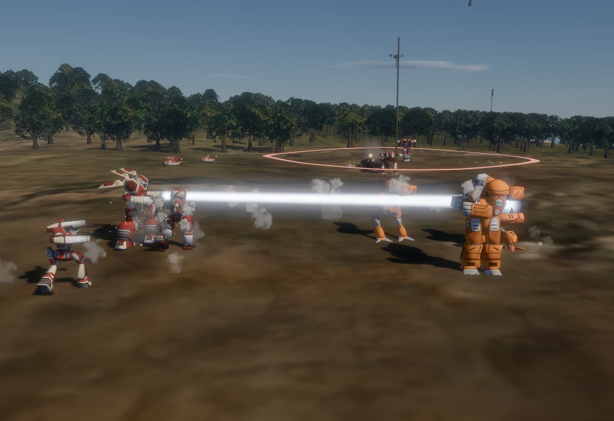

| | | |
|---|---|---|
| 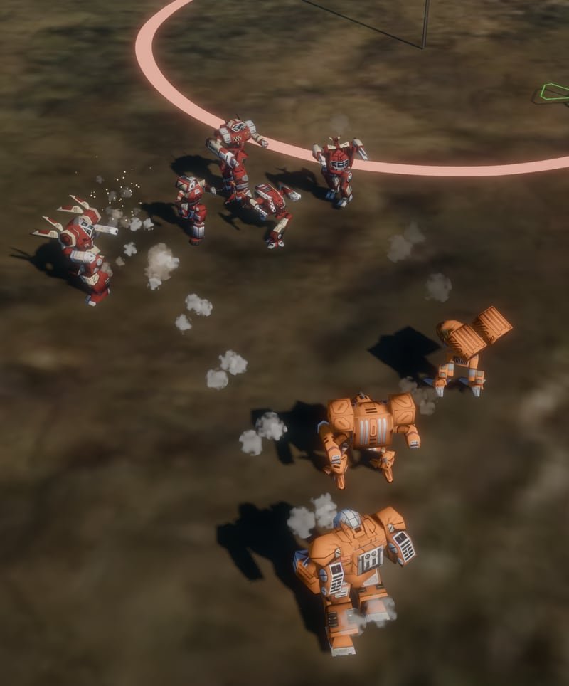 | 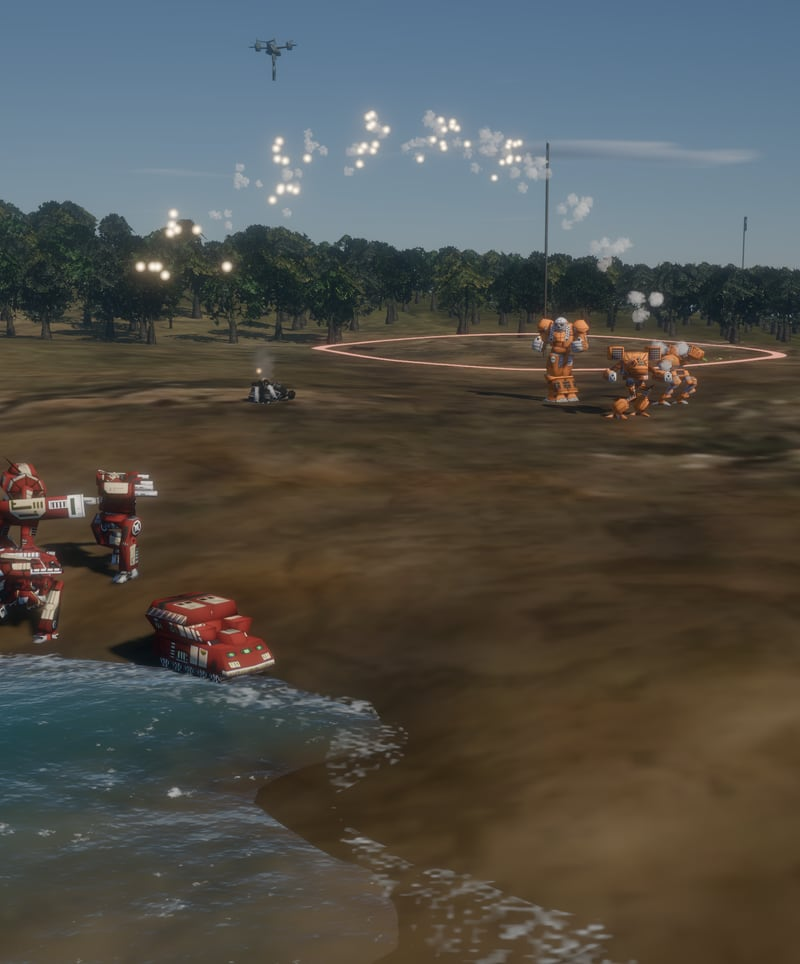 | 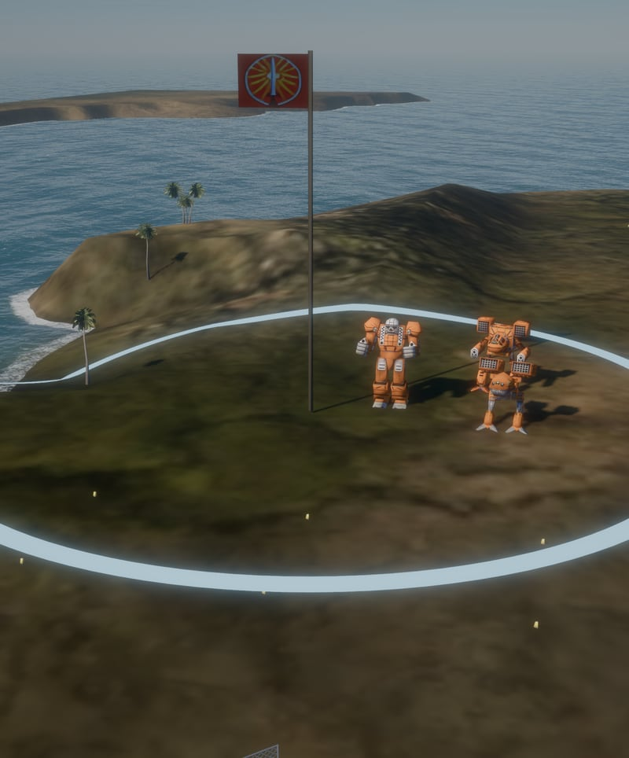 |

| | |
|---|---|
| 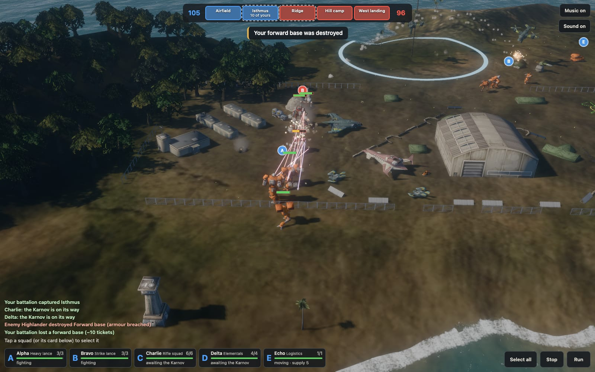 | 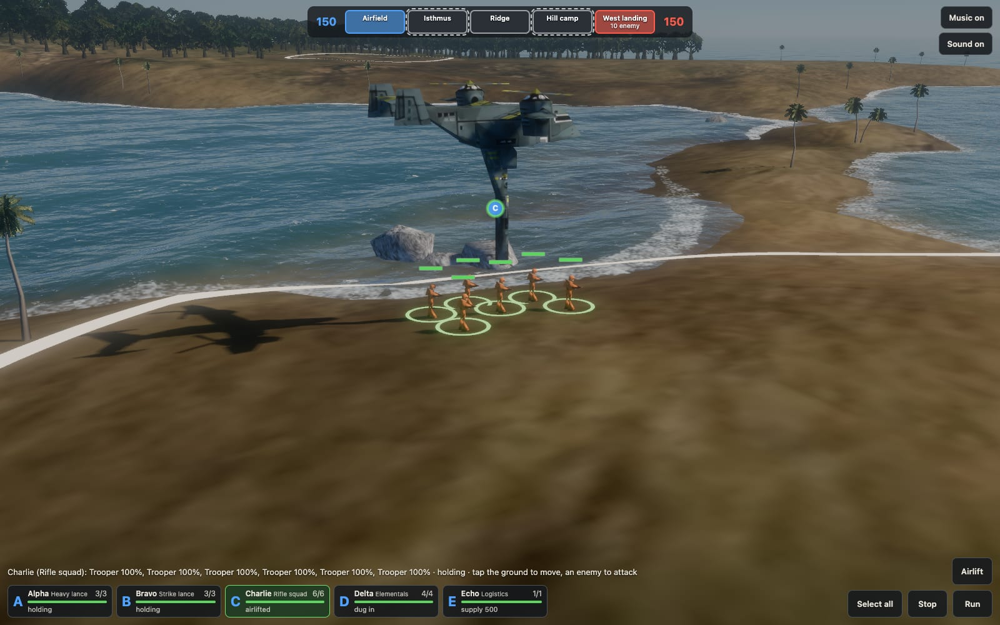 |
| 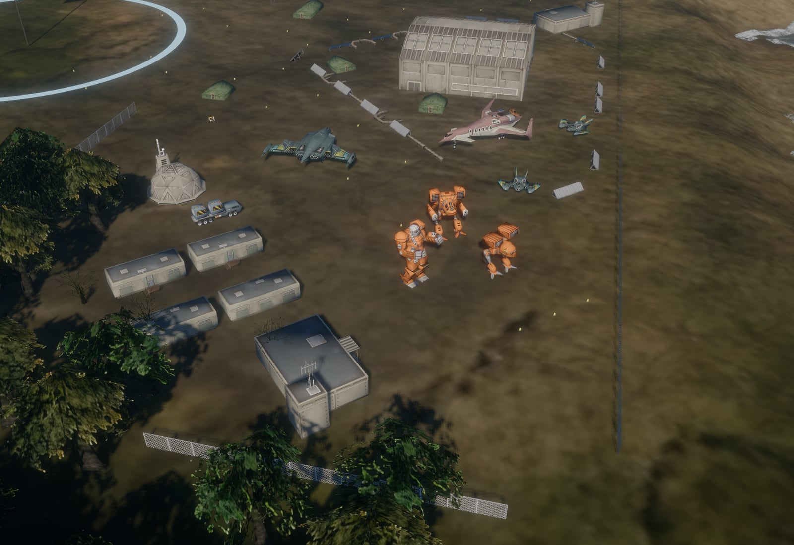 | 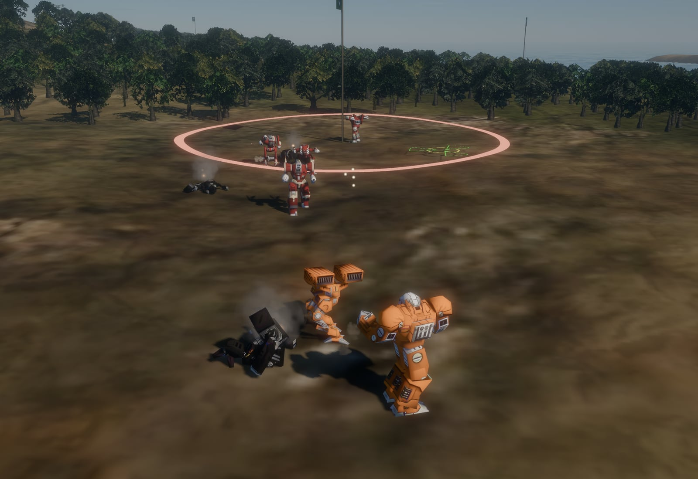 |
| 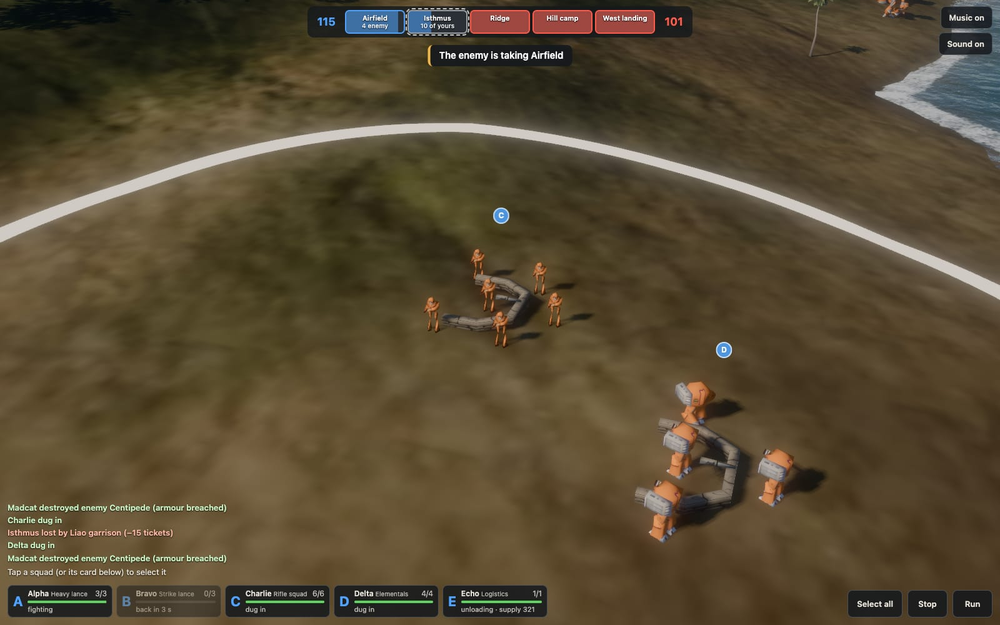 | 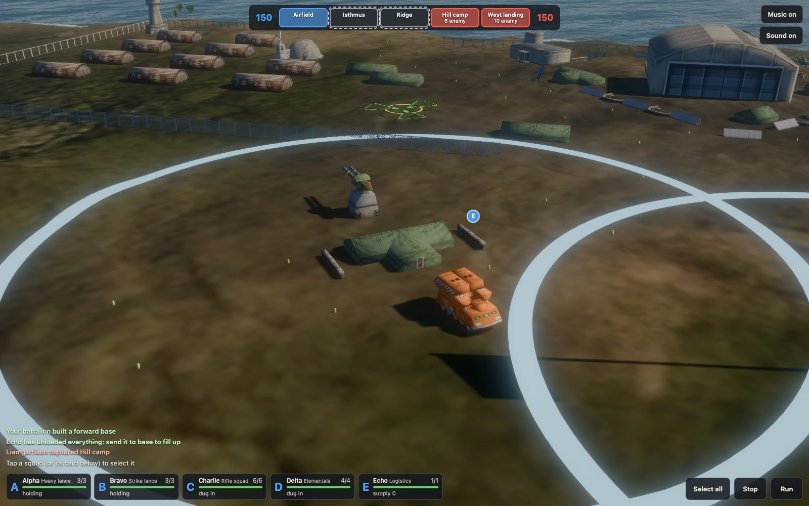 |
| 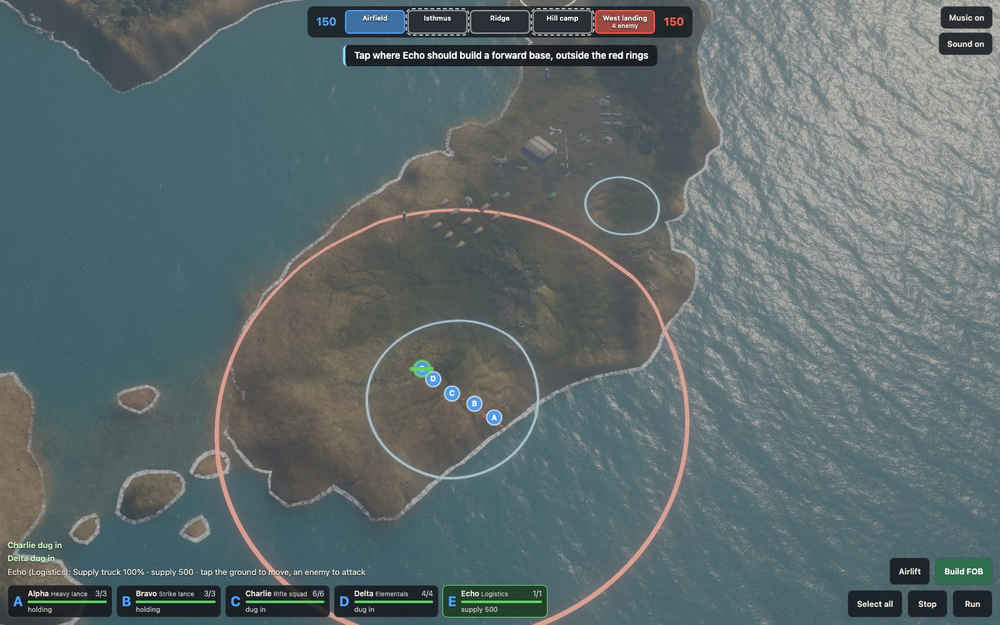 | 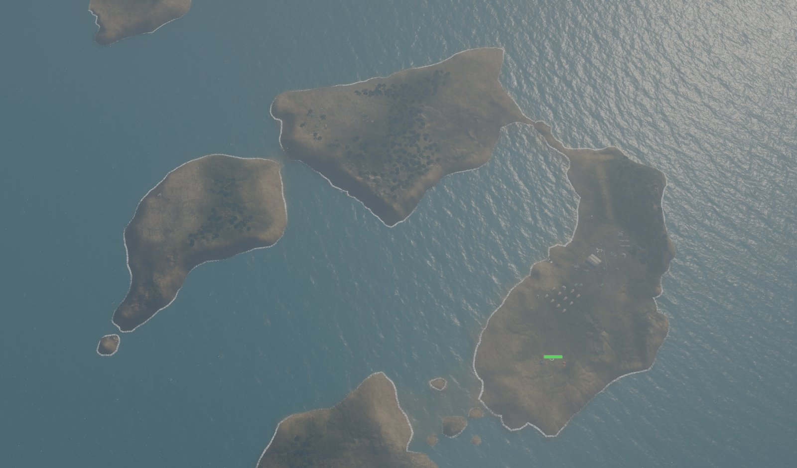 |

The pictures above without the HUD were taken on an iPad Air M2, with the dev server's
**Capture** button; those with it come from headless Chrome on a Mac, at full
render scale, mostly with both sides played by the AI.

## Quick start

```bash
npm install
npm run fetch-data       # sparse-clones only what mission mc2_01 needs (~46 MB) into vendor/
npm run convert          # writes public/assets/: maps, models and sound (ffmpeg encodes the music)
npm run dev:https        # https://localhost:5173, also on your LAN for an iPad
```

WebGPU only exists in secure contexts, so open the HTTPS address on an iPad and
accept the self-signed certificate once (Show Details → visit this website).
Plain `npm run dev` works on the Mac itself (localhost counts as secure); from
another device over HTTP the game falls back to the viewer.

The converter encodes MC2's music to AAC with `ffmpeg` (`brew install ffmpeg`);
without it on the PATH the game simply has no music.

Options (both scripts): `--mission mc2_05` picks another mission, and
`--extra-mechs atlas,madcat` adds mechs the mission doesn't use (the defaults
are the showcase mechs that patrol near the start).

### Upscaled textures

The remaster's author published 4× AI upscales of the terrain colour maps and
model textures as zips on the
[v0.3 release](https://github.com/ThranduilsRing/mc2-opengl-remastered/releases/tag/v0.3-release)
(2.7 GB in total). `--upscaled` downloads only the entries a mission needs, using
HTTP range requests (mc2_01: 39 files, 109 MB, into `vendor/upscaled/`):

```bash
npm run fetch-data -- --upscaled
npm run convert -- --upscaled    # assets grow from ~6 MB to ~8 MB
```

The 5120² colour map is shipped at `--colormap-size 2560` (about 35 MB of GPU
memory with mipmaps, against about 140 MB at full size). Model textures are capped at
`--texture-size 512` and stored as WebP inside the GLBs (`EXT_texture_webp`).

### Publishing

`.github/workflows/pages.yml` builds the site on every push to `master` (or by
hand from the Actions tab) and deploys it to GitHub Pages. In the repository's
settings, set **Pages → Build and deployment → Source** to **GitHub Actions**. The
build fetches and converts the mission with `--upscaled`, as above, and caches
`vendor/` between runs. It sets the site's base path from the Pages
configuration (`/mech-command-web/` for a project site; `BASE_PATH` in
`vite.config.ts`).

The performance panels report to the dev server, so a published build hides
them; add `?perf` to the URL to run one anyway (it can't send the report).

## The game (WebGPU)

Controls: drag to pan, right-drag or two fingers to turn and tilt, scroll or
pinch to zoom. Tap a squad (or its card along the bottom) to select it,
long-press (or shift-click) to add one to the selection or take it out, or use
**Select all**; tap the ground to send the selection there, or an enemy to attack
it. A second tap on a selected squad's card looks at it, and a tap on a point in
the top bar looks at the point. **Stop** halts them (and drops an attack order)
and **Run** makes mechs run. **Airlift** appears when the selection has
infantry, and **Build FOB**, **Build turret** and **Build wall** when it has a
supply truck: press one, then tap the ground.
**Artillery** and **Air strike** call in a strike, and **Sensor probe** drops a
probe: press one, then tap where it should land (they show how long until
they're ready again). **Artillery piece**, **Scout** and **Minelayer** call in a
support unit by VTOL: press one, then tap where it should set down. **Lay mines**
appears when the selection has a minelayer: press it, then tap where it should
lay them to.
**Easy**, **Normal** or **Hard** (top right) is the difficulty: how well the
enemy's pilots shoot. Easy is the scenario as written, where yours are the
better pilots; Normal and Hard make the enemy's 5 and 10 points likelier to hit
(a pilot's gunnery is their chance to hit). The game starts on Normal. Tap it
to change it: it takes effect at once, on the units already fighting too, and
is remembered.
**Music** and **Sound** next to it turn each on or off.

### Advance and Secure

The game plays a scenario (`scenarios/*.json`, chosen by map), modelled on the
game *Squad*. You command squads in real time: two lances of mechs, a rifle
squad with its APC, a squad of Elementals (power armour), a pair of helicopters
and a supply truck. The Liao garrison has two lances, an armour squad, LRM
carriers, riflemen with a troop transport, Elementals and helicopters, run by a
simple AI commander.

- **Points.** Five capture points run along the islands from your base to
  theirs. Each side can take only the next point beyond the ones it holds:
  standing in its circle with no enemy there turns it, faster with more units
  (an enemy point goes neutral first); buildings (turrets, walls) don't count.
  The top bar shows tickets, each point's holder and progress, and the points
  in play (dashed).
- **Tickets.** Every unit lost costs its side tickets (a mech by its weight, 4
  to 10; a helicopter or an Elemental 2; a soldier or a vehicle 1, as a vehicle
  goes down to a hit or two), and so does every point lost. A side loses when its tickets run out, or wins by
  holding every point.
- **Bases.** A wiped-out squad comes back at its base after a while. A squad
  standing at its base gets missing members back one at a time, and its
  armour, structure and ammunition refitted.
- **Fog of war.** You see only the enemies your units see (225 m, the ground
  blocks the view); their squad letters show while they're seen. Your sensors
  pick up more, as red blips (see Sensors).
- **Infantry** are MC2's own soldiers and Elementals, drawn 1.8 times life size
  so they can be found among mechs. They're harder to hit than in MC2 (half as
  often, Elementals 70%, and less again in woods), and as cheap as tickets go.
- **Water.** Mechs wade the shallows MC2's movement map allows (up to about
  4 m), hovercraft (the Centipede and Harasser, flagged so in their object files)
  cross any water, tracked vehicles and infantry keep to land and fords
  under a metre, and helicopters fly over all of it.
- **Airlift.** Infantry are slow and keep to land, so MC2's Karnov VTOL flies
  them: select an infantry squad, press **Airlift** and tap where to drop it, or
  just send it somewhere it can't walk to. The Karnov lifts off from the base,
  comes in on its own landing animation, hovers with its cargo arm down while the
  squad boards, and sets it down at the other end. It can't be shot down, and the
  squad can't be hurt while aboard. It carries supply trucks and tracked vehicles
  the same way: the Liao base is on an island of its own, so its LRM carriers
  fly to the fight.
- **APCs.** Charlie, your rifle squad, has MC2's APC (15 t, unarmed, 23 m/s),
  and the Liao riflemen its troop transport (25 t, more armour, 15 m/s). Send
  the squad somewhere its APC gets it to sooner than it would walk (200 m or
  more): the squad waits while the APC drives over, walks to it and gets in, and
  rides there at the APC's top speed, about four times as fast as soldiers walk
  (MC2's run; other vehicles go at its walk, 9 m/s). They get out in a ring
  round it at the other end, and the APC waits 40 m behind them; on shorter moves
  it follows on behind. They also get out as soon as fire lands about the APC or
  an enemy is seen within 150 m of it, and go on on foot while it backs off 80 m.
  Stop, an attack order or an airlift gets them out where they are (the Karnov
  carries the APC too). If it's destroyed with them aboard, each soldier has an
  even chance of getting out alive. A lost APC costs a ticket, and the squad gets
  a new one at a base like a missing member. MC2 has the makings of this,
  compiled out: Elementals boarding a carrier (`TACTICAL_ORDER_LOAD_INTO_CARRIER`,
  ten seats) and getting out round it. In MC2's missions the APCs are only convoy
  targets.
- **Helicopters.** In MC2 a helicopter is a mech that flies (its object file
  says `MoveType = 1`), and each side has a pair: an Attack Copter (one AC10)
  and a Heavy Copter (four Streak SRM2s and two pulse lasers). As in MC2 they
  start on the ground, and take off on MC2's own 4-second animation when sent
  somewhere or when an enemy comes near, raising dust (spray over water). They fly
  at about 20 m over land, water and trees alike, see over hills, and set down at a
  base when they have nothing to do. Their guns face only ahead, so they turn
  to their target. MC2's rules for them: they can't take a point, artillery and
  air strikes can't touch them in the air (only on the ground), and shooting one
  down isn't a mech kill. Their armour is a light mech's, with nothing behind
  it, and one lost costs 2 tickets. MC2's take-off, landing and crash sounds
  play; in flight they're silent, as in MC2.
- **Digging in.** Infantry that stand still for 8 seconds dig in behind
  sandbags (MC2's sandbag bunker) and are much harder to hit until they move:
  mechs take ground fast, infantry are flown in to hold it.
- **Suppression** (this project's rule, after *Squad*; MC2 has none). Every
  shot that lands, hit or miss, suppresses the enemies near where it lands, by
  its damage: missiles' explosions and machine-gun bursts most, beams least.
  Soldiers take it fully, vehicles less than half, mechs a quarter, and it fades
  a few seconds after the fire stops. A suppressed unit aims worse (up to 60%
  worse for soldiers, 40% for mechs). Soldiers suppressed enough are **pinned
  down**: they stay where they are (and go on once the fire slackens), don't count
  toward taking a point, can't dig in, and are a little harder to hit. Dug-in
  soldiers take well under half of it, soldiers in woods less. Squad cards and
  letters show it, and a squad pinned down says so on the radio. So the Catapult
  and the LRM carriers earn their keep even when they miss: pin the defenders,
  then close in.
- **Artillery and air strikes.** Each side can call in MC2's strikes
  (`objects/artsml.fit`, `artbig.fit`): artillery, ready every 2 minutes, and an
  air strike, every 4, flown by MC2's Slayer aerospace fighter on its own
  bombing-run animation. Press one and tap a spot one of your squads can see,
  or your sensors reach.
  MC2's marker spins there and a ring shows the strike's reach; 7 seconds later
  it lands, as MC2's do, and every unit within 80 m takes MC2's hits (within
  25 m, more of them): artillery 8 damage a hit, the air strike 15. It hits your
  units too, and dug-in soldiers take half. The engine's incoming whoosh plays
  5.5 seconds out and the fighter dives in 2.5 seconds out. The bursts pin down
  soldiers nearby. When the enemy calls one near your units you get the red ring,
  a warning and the alarm, and the squad in the way calls it in: run. The AI
  calls its strikes on your units bunched up (a mech counts most), never where
  its own would be hit.
- **Sensors.** As in MC2 (`code/contact.cpp`), a side also picks up the enemy
  beyond sight, through hills, within its sensors' reach. Those none of your
  units see show as red blips: where something is, not what. Nothing can fire
  at a blip, but artillery and air strikes can be called on one. The sensors are
  MC2's own: the Raven's Advanced sensors reach 550 m and the Werewolf's
  Extended 400 m (other mechs' standard sensors add nothing to sight, and a
  critical hit to the head can knock them out); every forward base raises MC2's
  sensor tower, which watches 550 m about it and falls to 11 points of damage;
  and **Sensor probe** drops MC2's probe on any spot, ready 45 seconds in and
  then every 3 minutes. A probe picks up everything within 800 m, a reach that
  shrinks steadily to nothing over 2 minutes (its ring shows it). The Raven's
  ECM keeps it off the enemy's sensors. Betty says when a probe is ready, when
  your tower picks the enemy up after a quiet minute, and when it's destroyed,
  in MC2's lines for those (the engine has the tower lines but never plays them).
  None of the Liao garrison's mechs carry sensors: it has its towers and probes.
- **Support units.** MC2's support menu also sends units, each brought by its
  VTOL (`tgl/vtol`, on its own drop-off animation): press **Artillery piece**,
  **Scout** or **Minelayer** and tap open ground your squads can see. The VTOL
  flies in from your base, sets the unit down about 5 seconds later and flies
  off, and MC2's support desk says what's coming. Each comes as a squad of one
  with its own card (Long Tom, Pegasus, Sapper), ordered like the others. MC2
  buys them with resource points; here a side has one of each at a time, as
  with strikes: the scout is ready 30 seconds in, the minelayer at 1½ minutes
  and the artillery piece at 3, and another 2½, 4 and 5 minutes after the last
  is lost (its button shows the wait, and hides while one is out).
  - The **artillery piece** is MC2's guard tower (`objects/guardtower.fit`): a
    40-tonne Long Tom that never moves and can't take a point. It shells what
    your side sees from 60 to 180 m off (MC2's long range; its crew see 270 m,
    a fifth further than most), one shell every 7 seconds, 50 in all. A shell
    bursts where it lands, hit or miss, and everything on the ground within
    37 m takes its 15 damage (MC2's area effect, `objects/longtom.fit`), yours
    too: it holds fire while any of your units are that near its target. Its
    armour is thin (22 to 30 a side), so keep it back. Betty warns when it's
    attacked and when it's destroyed, in MC2's guard tower lines.
  - The **scout** is MC2's scout helicopter (`objects/scoutcopter.fit`): 5
    tonnes, a machine-gun array, and a pilot who sees 270 m. Send it ahead to
    spot for strikes, LRMs and the Long Tom.
  - The **minelayer** (`objects/minelayer.fit`): select it, press **Lay mines**
    and tap where it should drive. As in MC2 it lays a mine in each cell of the
    movement map it passes (one every half second), 160 in all; Betty says when
    they're gone, and it loads more at a base as others refit. A mine goes off
    under a mech or vehicle of more than 35 tonnes, doing 12 damage to a leg or
    the front (the pilot says so), and a strike or Long Tom shell sets off the
    mines about it; helicopters, soldiers and light machines pass over. Everyone
    sees every mine (red rings), and routes don't go round them (MC2's mine
    avoidance is compiled out): steering clear is up to you. Unlike MC2, a
    side's own mines don't go off under its own units.
  The AI calls them in too: the artillery piece 110 m behind the point it holds
  at the front (on the far side from the enemy's way in), the scout to watch the
  point it's attacking from 160 m short of it, and the minelayer to lay three
  lines of mines across the way the enemy comes to the point it holds. Anything
  that can't move (the artillery piece, a turret) picks its targets among those
  its guns reach from where it stands, and a scout fires at what comes near but
  goes after it only when ordered.
- **Forward bases.** Each side has a logistics squad: MC2's repair truck,
  carrying its 500 refit points as supply. Select it, press **Build FOB** and
  tap a spot (red rings show where it can't go: within 300 m of your main base
  and other forward bases, or 250 m of the enemy's): it drives there, a ring
  marking the spot, and spends 15 seconds and 300 supply raising MC2's HQ tent
  behind sandbags, guarded by an autocannon turret (two AC10s, its own gunner)
  and watched over by a sensor tower.
  A countdown shows over the truck, and another order calls the build off. Wiped-out
  squads come back at the one nearest the front, squads there reinforce and
  refit, and the Karnov flies from it; all of that costs its supply (a mech its
  weight twice over, a soldier 10). A truck standing at the main base fills up;
  one standing at a forward base unloads into it. The battle log says when a
  truck is empty, when a forward base runs dry, and when a squad came back at
  the main base because no forward base could pay for it. Destroy the tent and
  the base is gone (10 tickets). The AI builds a forward base back from the point
  it's attacking and keeps it supplied, and puts up two turrets in the point it
  holds at the front and a stretch of wall in front of it.
- **Turrets and walls.** A supply truck also builds, for supply, a turret (the
  forward base's autocannon turret: 100 supply, 10 seconds) anywhere outside the
  enemy's base, or a stretch of wall (50 supply, 8 seconds): two of MC2's light
  wall pieces end to end, 56 m in all, across the way the enemy comes at that
  spot (toward the next point on their side), built from behind. As in MC2, a
  wall closes the ground it stands on to everything but aircraft, though not
  sight or fire, and each piece comes down to 30 points of damage
  (`davionlightwall.fit`). Walls are shot at only when you order it (tap one).
  Units on their way through go round. A wall can't go where it would cut a
  point or a base off from anywhere it can now be reached from, by any way of
  moving: walls slow the enemy and steer it round, into your turrets' fire, but
  can't shut it out (on this map only one spot would). A side keeps up to 6
  turrets and 6 stretches of wall.
- **Radio.** Your squads answer over the radio in MC2's pilots' voices (each squad
  its own, set in the scenario): acknowledging orders, refusing ones they can't
  carry out ("can't get there", an illegal order), and calling out new contacts,
  attacks, crippled mechs, ejecting pilots, kills and finished refits. They follow
  MC2's radio rules (`sound/radio.csv`): one voice at a time, the most urgent
  first, stale lines dropped. Betty, MC2's computer voice, announces points
  taken, a forward base or the artillery piece under attack or destroyed,
  supply or mines run out, and the result. A refused order also shows why in the middle of the screen, with MC2's
  buzz, and the alarm sounds when the enemy starts taking one of your points.
  **Sound on/off** (top right) is remembered. On iPad, sound starts with the
  first tap and plays even with the silent switch on.
- **Battle sounds and music.** Weapons fire with MC2's sounds, the ones the
  engine plays for each (a weapon's effect names its bolt, whose file names the
  sound), at MC2's volumes; shots land with MC2's hit explosion sounds, and mechs,
  vehicles and the forward base's tent blow up with its explosions. Sounds fade
  with distance from what the camera looks at (and as it zooms out), are panned
  to the side of the screen they're on, and you only hear the enemies your side
  can see. A few at most play at once, and the fight quietens while someone
  speaks on the radio. The music is MC2's: the mission's own tune to open, the
  ambient tune while it's quiet, the combat tunes while your squads fight, and
  the win or lose tune at the end. **Music on/off** sits by the sound button.

The AI sends most of its squads at the point it can take next, holds the
one it must keep with the rest, stands its LRM carriers off behind the attack,
flies its infantry to far or cut-off points (and its vehicles to cut-off ones),
drives its riflemen in their troop transport where that's quicker, and pulls
badly hurt squads back to
reinforce. It sends its helicopters with the attack, and lands them at its base
to refit. It drops a sensor probe on the point it's attacking when its
sensors don't reach there, and calls strikes on what its sensors pick up as
well as what it sees. Its Karnovs set infantry down out of sight of every enemy it has seen
in the last minute, and well clear of any point you hold or have units in (the
HUD shows it those counts, as it shows you); if the landing zone turns hot on
the way, the Karnov goes somewhere else. Infantry don't go in on a point you hold
ahead of their mechs and vehicles: they dig in out of sight and wait, then go in
with them, and so do its helicopters, which would otherwise get there first and
be shot down. Played against itself (both sides then fight by its rules), a
match runs about 8 to 10 minutes. Before the helicopters, on Easy your side won
five of six, by 15 to 64 tickets, and Liao one by 16 (your pilots are the
better: gunnery 45 to 55 against Liao's 38 to 42); on Normal and Hard, Liao won
four of six (three of each: too few to tell the two apart). With them, on
Normal your side won five of six, by 13 to 49 tickets, and Liao one by 20. With
the APCs too, your side won all three, by 24 to 96: each side rode two to four
times a match, nearly every ride ending with the soldiers getting out under fire
short of the point, and in nine matches one APC was lost with a squad aboard.
With sensors as well, Liao won two of three, by 29 and 49 tickets, and your side
one by 8: each side dropped two or three probes a match and built one or two
towers, and about half the strikes went in on enemies only sensors had picked
up. With turrets and walls too, your side won two of three, by 26 and 45, and
Liao one by 7: each side's truck put up two to six turrets a match (which made
one to seven kills a side), and hardly any walls, as the spot in front of a
point the AI holds is often water. With support units too, your side won two
of three, by 24 and 28, and Liao one by 29: each side called in two or three
scouts, one or two minelayers and one or two artillery pieces a match, a Long
Tom made up to six kills, and a side's mines went off under the enemy up to 11
times. A match can swing by 70 tickets, so a
handful of matches shows a trend at best. `?scenario=none` shows the mission's
own units instead (your lance is then its three mechs plus an Atlas and a
Madcat), and `?speed=4` runs the world four times as fast (for testing).

Orders are routed over MC2's movement map (`src/sea/sim/move-grid.ts`): A* over its
300×300 cells of 8.5 m with the engine's rules (no off-map cells or deep water,
shallow water and passable ground only, forest about 2.8× the cost of clear
ground), then pulled tight so routes only turn where something is in the way.
Walls close the cells under them while they stand. Ground vehicles, hovercraft and infantry (in MC2's code its soldiers are ground
vehicles too) keep to the roads: a road cell costs them a quarter of clear ground
(`MOVEPARAM_FOLLOW_ROADS`, set for every ground vehicle). They're no faster
there, so a route by road can be the longer one: from your base to the Ridge
it's about 1.6 km, a fifth of it on road, where a mech walks 1.35 km. A
squad's members take formation slots about the point, the nearest in the middle,
and squads sent together spread out side by side.

### Combat

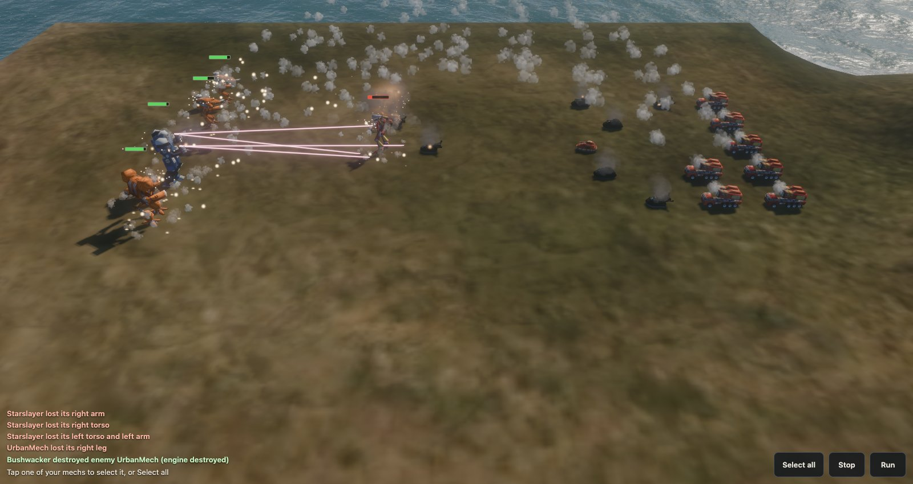

Combat follows MC2's own code (`code/mover.cpp`, `mech.cpp`, `gvehicl.cpp`) on
data the converter exports to `combat.json`: weapons from `compbas.csv`, each
mech's armour, structure, loadout and crit slots from its stats CSV, vehicles
from their object files, and each pilot's gunnery from the mission's warrior
profiles. In short:

- Every quarter second each unit picks a target (the one it was ordered to
  attack, else the nearest enemy its side can see within 275 m; sight is 225 m
  and the ground blocks it). Your mechs hold their ground unless ordered to
  attack, and fire at whatever comes in range, turning to face it.
- Units fight from the distance their weapons do best from, as in MC2: 20 m for
  a brawler with only short-range weapons, 45 m for most mixed loadouts, 100 or
  160 m for long-range ones. Once a second a fighting unit checks its distance
  to its target; more than about 25 m off, either way, it walks to a spot on a
  ring at its distance (backing off when the enemy is too close), one it can see
  the target from and away from where its lancemates are going. The enemy's
  units keep moving round that ring while they fight, as MC2's AI does (a
  calmer step every few seconds), and stop to fight what they meet on their way
  to a point. A unit whose guns face only ahead (the Centipede, Elementals,
  helicopters) holds its spot instead, and turns to keep its target within its
  12.5° fire arc. Units keep a few metres apart (a mech or vehicle 8.5 m, MC2's
  movement-map cell), so none stands inside another.
- Every loaded weapon in its range band (short, medium, long), in sight and
  within 12.5° of where the torso points fires; a mech's torso turns 120° either
  way. Lasers and PPCs strike at once, shells and missiles fly at the original
  speeds and do their damage when they land.
- A shot hits when d100 is under the pilot's gunnery (5–95%): nothing else
  changes the odds in the original. Where it lands depends on the side it came
  from. Damage goes through armour, then structure (with critical hits: engine,
  cockpit, weapons, exploding ammunition), then inward. Heat isn't modelled,
  because the original compiles it out.
- Destroyed mechs fall, explode and burn, and are redrawn as burnt-out wrecks.
  Health bars show over the selection and anything damaged, and the battle log
  reports kills and lost limbs.

`src/sea/README.md` has the details, and how they were checked against a
simulation of the original rules.

### Rendering

The sea, sky, surf and post-processing come from the dreadnought game; see
`src/sea/README.md` for what was taken and what changed. MC2's land wears its
pre-lit colour map, and the sea shows the sea floor through shallow water. Every
model is one vertex buffer whose vertices name the node they move with, so all
the mechs of one type are a single instanced draw. The sun's shadows fade out as
the camera zooms out (700–1000 m).

### Performance surveys

Three buttons (top left) measure the game on the device it runs on. Each report
is POSTed to `/api/perf` and saved in `perf-reports/`.

- **Run sea survey** measures what the sea, land, buildings, units, shadows,
  sky, bloom and resolution each cost per frame, from two fixed views: the
  opening view, and the whole map zoomed out (mostly sea). It renders several
  frames per display refresh, until one interval spans at least six refreshes,
  so the 60 fps cap can't hide the cost; each row is a range accurate to about a
  sixth.
- **Run battle survey** puts every unit on the map (23) into one fight on open
  ground. It measures the same way with the fight running and nobody able to be
  hurt, so the fire stays steady (standing, fighting, without effects, without
  shadows, at 75%), then plays the fight in real time until one side is
  destroyed, recording frame intervals, JavaScript time and peak particles.
- **Run pacing survey** plays the opening view in real time nine ways, taking
  away one suspect at a time (the GPU timer, HUD updates, the model matrix
  upload, resolution, most of the scene, everything but a cleared screen), to
  find what makes frames late.

URL options: `q=B` for 128² waves instead of 256², `msaa=1`, and `scale=` for a
fixed render scale.

On an iPad Air M2, against 16.7 ms a frame at 60 fps:

| | GPU per frame |
|---|---|
| Opening view | 3.0–3.5 ms |
| Whole map zoomed out | 10.0–10.6 ms (the sea is about 6 ms of it) |
| All 23 units fighting, wide or close | 3.3–4.4 ms (effects cost next to nothing) |

In real time the page holds 60.0 fps from the opening view in every pacing
variant. A whole 23-unit fight, played after the battle survey's stress rows,
ran at 57.4 fps with no frame over 31 ms and 2–5 ms of JavaScript a frame; ten
seconds of standing still at that point paced the same, so the shortfall is the
device after minutes of stress rendering, not the fight.

### Screenshots from a device

On the dev server, **Capture** (top right) takes a picture on the device the game
runs on, an iPad say, and sends it to the Mac. It copies the next frame off the
GPU at full render scale, without the selection rings and without the page's
HTML (the cards, the top bar, the squad letters), and the dev server saves it as
a PNG in `screenshots-inbox/` (git-ignored), with the camera's view and the match
time in a JSON file beside it. For shots with the HUD, use the device's own
screenshot.

## The viewer (WebGL)

Controls as above. Its panel switches animations, toggles run/patrol, spawns
mechs, hides layers and toggles shadows. Add `?map=<mission>` to the URL of either
page to choose a converted map.

Its **Run perf test** button measures seven scenes (opening view with and without
shadows and at half resolution, the airfield, the whole map, a walking Atlas up
close, 24 extra walking mechs), plus load milestones, WebGL limits and the WebGPU
adapter's features. The report goes to the same `/api/perf` endpoint.

## Layout

| Path | What |
|---|---|
| `tools/fetch-srcdata.ts` | Sparse, blobless checkout of [alariq/mc2srcdata](https://github.com/alariq/mc2srcdata), resolving the files a mission needs |
| `tools/convert.ts` | Mission → `public/assets/maps/<mission>/`, `public/assets/models/` and `public/assets/sound/` |
| `tools/lib/` | Readers for `.pak`, `.fit`, `.tga`, `.ase` and remote zips, the glTF builder, the combat data export, and the choice of sounds (`sound.ts`) |
| `src/sea/` | The WebGPU game (`main.ts`, `app/`, `models/`, `render/`, `sim/`) |
| `src/sea/sim/combat.ts`, `src/sea/app/battle.ts` | MC2's combat rules, and the battle that runs on them |
| `docs/screenshots/` | The pictures in this README |
| `src/*.ts` | The three.js viewer; `src/paint.ts` and `src/assets.ts` are shared |
| `vendor/`, `public/assets/` | Downloaded and generated data; git-ignored |
| `perf-reports/`, `screenshots-inbox/` | What the dev server receives from devices (perf reports, captured frames); git-ignored |

Converted output per mission: `map.json` (terrain size, water, light, camera
start), `elevation.bin` (Float32 heights), `colormap.webp`, `objects.json`
(about 1,000 placed buildings and trees), `units.json` (mission units with their
pilots' gunnery, plus gesture speeds), `combat.json` (weapons, ammunition, and
each unit type's armour, structure, loadout and crit slots), and `move.bin` (the
300×300 movement grid). Shared by every mission: `sound/sound.json` (each radio
message's priority and shelf life from `radio.csv`, the scenarios' voices' lines
for each message, Betty's lines by their `BETTY_*` number, interface effects, each
weapon's firing and impact sounds, the explosions, and the tunes), MC2's WAVs as
they are (6.6 MB: five voices, then weapons and explosions), and
`sound/music/*.m4a`, ten of MC2's tunes encoded to AAC (4.7 MB, fetched one at a
time as they play).

## How the conversion follows the engine

The rules are taken from the C++ in
[mc2-opengl-remastered](https://github.com/ThranduilsRing/mc2-opengl-remastered):

- **Axes.** ASE files and the MC2 world share axes (x east, y north, z up). three.js
  uses `(x, z, -y)`. Model forward is world −y, which becomes +Z in three.js.
  Facing = `(sin r, −cos r)`, so `rotation.y = r`.
- **Terrain** (`mclib/terrain.cpp`, `mapdata.cpp`). 128 world units per vertex,
  centred on the origin, row 0 at the north edge. Quads split their diagonal in a
  checkerboard pattern. The colour map spans `side × 128` units and is pre-lit.
- **Models** (`mclib/tgl.cpp`, `msl.cpp`). Node rest rotations are ignored. Each node sits at
  its `TM_POS` relative to its parent. Face textures are the first N `*BITMAP` entries
  in file order, indexed by `MESH_MTLID`. `SpotLight_*` meshes (night lights) are dropped.
- **Animation.** Each gesture is its own ASE file (`<appearance><Gesture>.ase`).
  Rotation keys are axis/angle deltas, which the engine converts with its own signs and
  accumulates as `q[j] = key[j] · q[j−1]`. Clips are baked to one key per frame at 30 fps.
- **Speed.** Gesture velocities in the mech INI are metres per second, at 5.01 world
  units per metre.
- **Paint** (`mclib/mech3d.cpp`). Texels dominated by red, green or blue are recoloured
  with highlight 1, highlight 2 and the base colour. Player units use the default orange.
- **Water** (`mclib/quad.cpp`). Per-vertex opacity by depth (shallow, middle, deep). In
  mc2_01 deep water is opaque, which hides the seabed in the colour map.

Checks done against mc2_01:
- Every placed object's stored height matches the terrain sampler to within 0.01
  (a mirrored grid misses by 66–91 units at the median).
- Mechs face the way they walk.
- The walk cycle steps forward at the gesture speed.
- It renders in Chrome and in WebKit with iPad emulation, including tap to walk.

## Known gaps

- `alariq/mc2srcdata` lacks a few objects' models (some rocks, mech wreck pieces, nav
  markers). The converter skips any it can't find and lists them; mc2_01 and its
  scenario need none of them.
- Vehicles drive, but their turrets don't turn: the converter flattens each
  vehicle into one node, though the files name a turret node (`sc_turret`). Prop
  animations (flags, radar) are not converted.
- The data's damage models aren't used yet. MC2 hides a destroyed arm's nodes and
  throws a separate arm mesh (`<mech>leftarm.ase`, `rightarm.ase`) tumbling off
  with a smoke trail; a destroyed mech, once fallen, becomes a damaged wreck mesh
  (`<mech>fallforwarddam.ase`, `fallbackwarddam.ase`); a destroyed vehicle becomes
  `<vehicle>dam.ase` with a `dam` texture. Here arms stay on (their weapons just
  stop), and wrecks are the intact model painted in soot.
- Trees don't block sight, and enemies close and fire rather than following the
  mission's scripts.
- MC2's weapon bolts name no hit explosion, so the original played no sound for a
  shot landing: the impacts here are MC2's hit explosion objects' sounds, picked
  by the effects table's hit effect. There are no footstep, Karnov or weather
  sounds yet, and when each tune plays is this project's rule (MC2 left that to
  each mission's script).
- The original 1280² colour map is blurry close up; use `--upscaled`.
- Headless browsers on an Intel Mac can't stand in for an iPad when timing (they
  render even a near-empty scene at ~15 fps); measure on the device.

## Licence

The engine code these rules come from is GPL v3 (alariq's port) on top of
Microsoft's Shared Source release. The MechCommander 2 art (and sound) may be used and
redistributed **for non-commercial purposes only**, and the licence grants no rights
to Microsoft's trademarks (see `EULA.txt` in the engine repository). That's why
`vendor/` and `public/assets/` are git-ignored: anyone building this fetches and
converts the data themselves, and so does the Pages workflow. The published site
serves the converted art, so it must stay non-commercial. The `--upscaled` textures are the remaster author's AI
upscales of the same art, so the same non-commercial terms apply, as they do to the
screenshots in `docs/screenshots/`, which show it.
