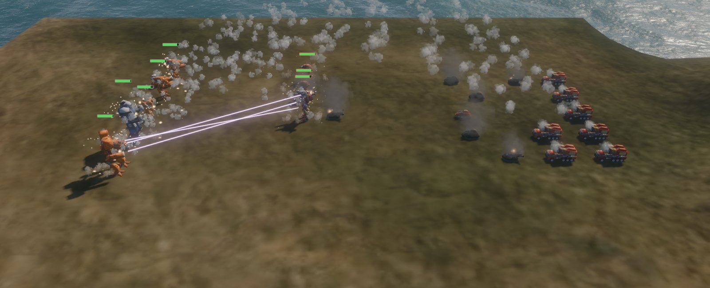
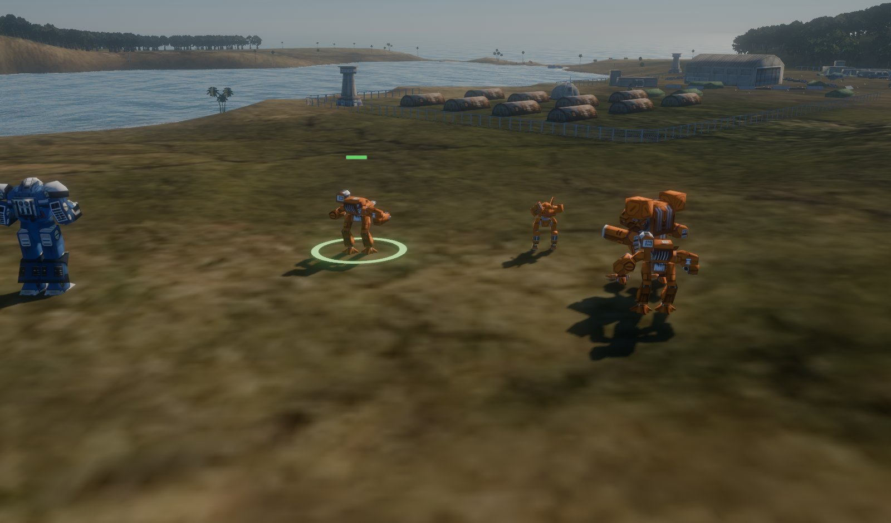
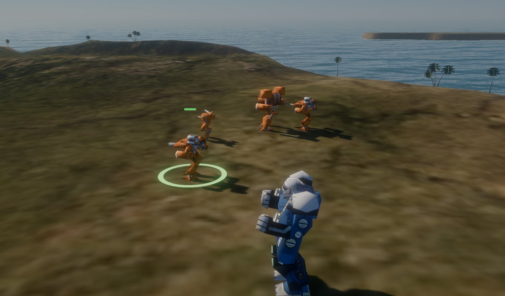
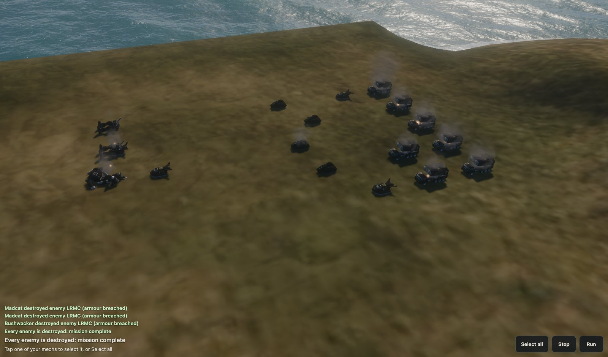

# Mech Command Web

A small MechCommander 2-style skirmish for iPad and desktop browsers, reusing
the original game's maps, buildings and mechs. No native code: the original
data is converted offline into glTF, WebP, PNG and JSON.

- **The game** (`index.html`) draws with WebGPU: the FFT sea and physically based
  sky from the dreadnought game, MC2's terrain, buildings, trees and mechs, and
  sun shadows. It needs Safari 26 (iPadOS 26 / macOS 26), or a recent Chrome or Edge.
- **The viewer** (`viewer.html`) is the earlier three.js/WebGL2 version. The game
  sends any browser without WebGPU there automatically.



| | |
|---|---|
|  |  |
|  |  |

Screenshots are from headless Chrome on a Mac, at full render scale.

## Quick start

```bash
npm install
npm run fetch-data       # sparse-clones only what mission mc2_01 needs (~46 MB) into vendor/
npm run convert          # writes public/assets/ (~6 MB)
npm run dev:https        # https://localhost:5173, also on your LAN for an iPad
```

WebGPU only exists in secure contexts, so open the HTTPS address on an iPad and
accept the self-signed certificate once (Show Details → visit this website).
Plain `npm run dev` works on the Mac itself (localhost counts as secure); from
another device over HTTP the game falls back to the viewer.

Options (both scripts): `--mission mc2_05` picks another mission, and
`--extra-mechs atlas,madcat` adds mechs the mission doesn't use (the defaults
are the showcase mechs that patrol near the start).

### Upscaled textures

The remaster's author published 4× AI upscales of the terrain colour maps and
model textures as zips on the
[v0.3 release](https://github.com/ThranduilsRing/mc2-opengl-remastered/releases/tag/v0.3-release)
(2.7 GB in total). `--upscaled` downloads only the entries a mission needs, using
HTTP range requests (mc2_01: 39 files, 109 MB, into `vendor/upscaled/`):

```bash
npm run fetch-data -- --upscaled
npm run convert -- --upscaled    # assets grow from ~6 MB to ~8 MB
```

The 5120² colour map is shipped at `--colormap-size 2560` (about 35 MB of GPU
memory with mipmaps, against about 140 MB at full size). Model textures are capped at
`--texture-size 512` and stored as WebP inside the GLBs (`EXT_texture_webp`).

### Publishing

`.github/workflows/pages.yml` builds the site on every push to `master` (or by
hand from the Actions tab) and deploys it to GitHub Pages. In the repository's
settings, set **Pages → Build and deployment → Source** to **GitHub Actions**. The
build fetches and converts the mission with `--upscaled`, as above, and caches
`vendor/` between runs. It sets the site's base path from the Pages
configuration (`/mech-command-web/` for a project site; `BASE_PATH` in
`vite.config.ts`).

The performance panels report to the dev server, so a published build hides
them; add `?perf` to the URL to run one anyway (it can't send the report).

## The game (WebGPU)

Controls: drag to pan, right-drag or two fingers to turn and tilt, scroll or
pinch to zoom. Tap a squad (or its card along the bottom) to select it,
long-press (or shift-click) to add one to the selection or take it out, or use
**Select all**; tap the ground to send the selection there, or an enemy to attack
it. A second tap on a selected squad's card looks at it, and a tap on a point in
the top bar looks at the point. **Stop** halts them (and drops an attack order)
and **Run** makes mechs run.

### Advance and Secure

The game plays a scenario (`scenarios/*.json`, chosen by map), modelled on the
game *Squad*. You command squads in real time: two lances of mechs, a rifle
squad and a squad of Elementals (power armour). The Liao garrison has two
lances, an armour squad, LRM carriers, riflemen and Elementals, run by a simple
AI commander.

- **Points.** Five capture points run along the islands from your base to
  theirs. Each side can take only the next point beyond the ones it holds:
  standing in its circle with no enemy there turns it, faster with more units
  (an enemy point goes neutral first). The top bar shows tickets, each point's
  holder and progress, and the points in play (dashed).
- **Tickets.** Every unit lost costs its side tickets (a mech by its weight), and
  so does every point lost. A side loses when its tickets run out, or wins by
  holding every point.
- **Bases.** A wiped-out squad comes back at its base after a while. A squad
  standing at its base gets missing members back one at a time, and its
  armour, structure and ammunition refitted.
- **Fog of war.** You see only the enemies your units see (225 m, the ground
  blocks the view); their squad letters show while they're seen.
- **Infantry** are MC2's own soldiers and Elementals, drawn 1.8 times life size
  so they can be found among mechs. They're harder to hit than in MC2 (half as
  often, Elementals 70%, and less again in woods), and as cheap as tickets go.

The AI sends most of its squads at the point it can take next, holds the
one it must keep with the rest, stands its LRM carriers off behind the attack,
and pulls badly hurt squads back to reinforce. Played against itself, a match
runs about 12 minutes and goes either way. `?scenario=none` shows the mission's
own units instead, and `?speed=4` runs the world four times as fast (for
testing).

Your lance is the mission's three mechs plus the Atlas and Madcat. Orders are
routed over MC2's movement map (`src/sea/sim/move-grid.ts`): A* over its
300×300 cells of 8.5 m with the engine's rules (no off-map cells or deep water,
shallow water and passable ground only, forest about 2.8× the cost of clear
ground), then pulled tight so routes only turn where something is in the way. A
group's mechs take formation slots about the point, nearest mech to the middle.

### Combat


Combat follows MC2's own code (`code/mover.cpp`, `mech.cpp`, `gvehicl.cpp`) on
data the converter exports to `combat.json`: weapons from `compbas.csv`, each
mech's armour, structure, loadout and crit slots from its stats CSV, vehicles
from their object files, and each pilot's gunnery from the mission's warrior
profiles. In short:

- Every quarter second each unit picks a target (the one it was ordered to
  attack, else the nearest enemy its side can see within 275 m; sight is 225 m
  and the ground blocks it). Enemies close to their best range; your mechs hold
  their ground unless ordered to attack, and fire at whatever comes in range.
- Every loaded weapon in its range band (short, medium, long), in sight and
  within 12.5° of where the torso points fires; a mech's torso turns 120° either
  way. Lasers and PPCs strike at once, shells and missiles fly at the original
  speeds and do their damage when they land.
- A shot hits when d100 is under the pilot's gunnery (5–95%): nothing else
  changes the odds in the original. Where it lands depends on the side it came
  from. Damage goes through armour, then structure (with critical hits: engine,
  cockpit, weapons, exploding ammunition), then inward. Heat isn't modelled,
  because the original compiles it out.
- Destroyed mechs fall, explode and burn, and are redrawn as burnt-out wrecks.
  Health bars show over the selection and anything damaged, and the battle log
  reports kills and lost limbs.

`src/sea/README.md` has the details, and how they were checked against a
simulation of the original rules.

### Rendering

The sea, sky, surf and post-processing come from the dreadnought game; see
`src/sea/README.md` for what was taken and what changed. MC2's land wears its
pre-lit colour map, and the sea shows the sea floor through shallow water. Every
model is one vertex buffer whose vertices name the node they move with, so all
the mechs of one type are a single instanced draw. The sun's shadows fade out as
the camera zooms out (700–1000 m).

### Performance surveys

Three buttons (top left) measure the game on the device it runs on. Each report
is POSTed to `/api/perf` and saved in `perf-reports/`.

- **Run sea survey** measures what the sea, land, buildings, units, shadows,
  sky, bloom and resolution each cost per frame, from two fixed views: the
  opening view, and the whole map zoomed out (mostly sea). It renders several
  frames per display refresh, until one interval spans at least six refreshes,
  so the 60 fps cap can't hide the cost; each row is a range accurate to about a
  sixth.
- **Run battle survey** puts every unit on the map (23) into one fight on open
  ground. It measures the same way with the fight running and nobody able to be
  hurt, so the fire stays steady (standing, fighting, without effects, without
  shadows, at 75%), then plays the fight in real time until one side is
  destroyed, recording frame intervals, JavaScript time and peak particles.
- **Run pacing survey** plays the opening view in real time nine ways, taking
  away one suspect at a time (the GPU timer, HUD updates, the model matrix
  upload, resolution, most of the scene, everything but a cleared screen), to
  find what makes frames late.

URL options: `q=B` for 128² waves instead of 256², `msaa=1`, and `scale=` for a
fixed render scale.

On an iPad Air M2, against 16.7 ms a frame at 60 fps:

| | GPU per frame |
|---|---|
| Opening view | 3.0–3.5 ms |
| Whole map zoomed out | 10.0–10.6 ms (the sea is about 6 ms of it) |
| All 23 units fighting, wide or close | 3.3–4.4 ms (effects cost next to nothing) |

In real time the page holds 60.0 fps from the opening view in every pacing
variant. A whole 23-unit fight, played after the battle survey's stress rows,
ran at 57.4 fps with no frame over 31 ms and 2–5 ms of JavaScript a frame; ten
seconds of standing still at that point paced the same, so the shortfall is the
device after minutes of stress rendering, not the fight.

## The viewer (WebGL)

Controls as above. Its panel switches animations, toggles run/patrol, spawns
mechs, hides layers and toggles shadows. Add `?map=<mission>` to the URL of either
page to choose a converted map.

Its **Run perf test** button measures seven scenes (opening view with and without
shadows and at half resolution, the airfield, the whole map, a walking Atlas up
close, 24 extra walking mechs), plus load milestones, WebGL limits and the WebGPU
adapter's features. The report goes to the same `/api/perf` endpoint.

## Layout

| Path | What |
|---|---|
| `tools/fetch-srcdata.ts` | Sparse, blobless checkout of [alariq/mc2srcdata](https://github.com/alariq/mc2srcdata), resolving the files a mission needs |
| `tools/convert.ts` | Mission → `public/assets/maps/<mission>/` and `public/assets/models/` |
| `tools/lib/` | Readers for `.pak`, `.fit`, `.tga`, `.ase` and remote zips, the glTF builder, and the combat data export |
| `src/sea/` | The WebGPU game (`main.ts`, `app/`, `models/`, `render/`, `sim/`) |
| `src/sea/sim/combat.ts`, `src/sea/app/battle.ts` | MC2's combat rules, and the battle that runs on them |
| `docs/screenshots/` | The pictures in this README |
| `src/*.ts` | The three.js viewer; `src/paint.ts` and `src/assets.ts` are shared |
| `vendor/`, `public/assets/` | Downloaded and generated data; git-ignored |

Converted output per mission: `map.json` (terrain size, water, light, camera
start), `elevation.bin` (Float32 heights), `colormap.webp`, `objects.json`
(about 1,000 placed buildings and trees), `units.json` (mission units with their
pilots' gunnery, plus gesture speeds), `combat.json` (weapons, ammunition, and
each unit type's armour, structure, loadout and crit slots), and `move.bin` (the
300×300 movement grid).

## How the conversion follows the engine

The rules are taken from the C++ in
[mc2-opengl-remastered](https://github.com/ThranduilsRing/mc2-opengl-remastered):

- **Axes.** ASE files and the MC2 world share axes (x east, y north, z up). three.js
  uses `(x, z, -y)`. Model forward is world −y, which becomes +Z in three.js.
  Facing = `(sin r, −cos r)`, so `rotation.y = r`.
- **Terrain** (`mclib/terrain.cpp`, `mapdata.cpp`). 128 world units per vertex,
  centred on the origin, row 0 at the north edge. Quads split their diagonal in a
  checkerboard pattern. The colour map spans `side × 128` units and is pre-lit.
- **Models** (`mclib/tgl.cpp`, `msl.cpp`). Node rest rotations are ignored. Each node sits at
  its `TM_POS` relative to its parent. Face textures are the first N `*BITMAP` entries
  in file order, indexed by `MESH_MTLID`. `SpotLight_*` meshes (night lights) are dropped.
- **Animation.** Each gesture is its own ASE file (`<appearance><Gesture>.ase`).
  Rotation keys are axis/angle deltas, which the engine converts with its own signs and
  accumulates as `q[j] = key[j] · q[j−1]`. Clips are baked to one key per frame at 30 fps.
- **Speed.** Gesture velocities in the mech INI are metres per second, at 5.01 world
  units per metre.
- **Paint** (`mclib/mech3d.cpp`). Texels dominated by red, green or blue are recoloured
  with highlight 1, highlight 2 and the base colour. Player units use the default orange.
- **Water** (`mclib/quad.cpp`). Per-vertex opacity by depth (shallow, middle, deep). In
  mc2_01 deep water is opaque, which hides the seabed in the colour map.

Checks done against mc2_01:
- Every placed object's stored height matches the terrain sampler to within 0.01
  (a mirrored grid misses by 66–91 units at the median).
- Mechs face the way they walk.
- The walk cycle steps forward at the gesture speed.
- It renders in Chrome and in WebKit with iPad emulation, including tap to walk.

## Known gaps

- `alariq/mc2srcdata` has no models for some objects (a few rocks, mech wreck pieces,
  nav markers, infantry, the outhouse). The converter skips them and lists them.
- Vehicles drive, but their turrets don't turn: the converter flattens each
  vehicle into one node, though the files name a turret node (`sc_turret`). Prop
  animations (flags, radar) are not converted.
- The data's damage models aren't used yet. MC2 hides a destroyed arm's nodes and
  throws a separate arm mesh (`<mech>leftarm.ase`, `rightarm.ase`) tumbling off
  with a smoke trail; a destroyed mech, once fallen, becomes a damaged wreck mesh
  (`<mech>fallforwarddam.ase`, `fallbackwarddam.ase`); a destroyed vehicle becomes
  `<vehicle>dam.ase` with a `dam` texture. Here arms stay on (their weapons just
  stop), and wrecks are the intact model painted in soot.
- Trees don't block sight, there's no fog of war, and enemies close and fire
  rather than following the mission's scripts.
- The original 1280² colour map is blurry close up; use `--upscaled`.
- Headless browsers on an Intel Mac can't stand in for an iPad when timing (they
  render even a near-empty scene at ~15 fps); measure on the device.

## Licence

The engine code these rules come from is GPL v3 (alariq's port) on top of
Microsoft's Shared Source release. The MechCommander 2 art may be used and
redistributed **for non-commercial purposes only**, and the licence grants no rights
to Microsoft's trademarks (see `EULA.txt` in the engine repository). That's why
`vendor/` and `public/assets/` are git-ignored: anyone building this fetches and
converts the data themselves, and so does the Pages workflow. The published site
serves the converted art, so it must stay non-commercial. The `--upscaled` textures are the remaster author's AI
upscales of the same art, so the same non-commercial terms apply, as they do to the
screenshots in `docs/screenshots/`, which show it.
